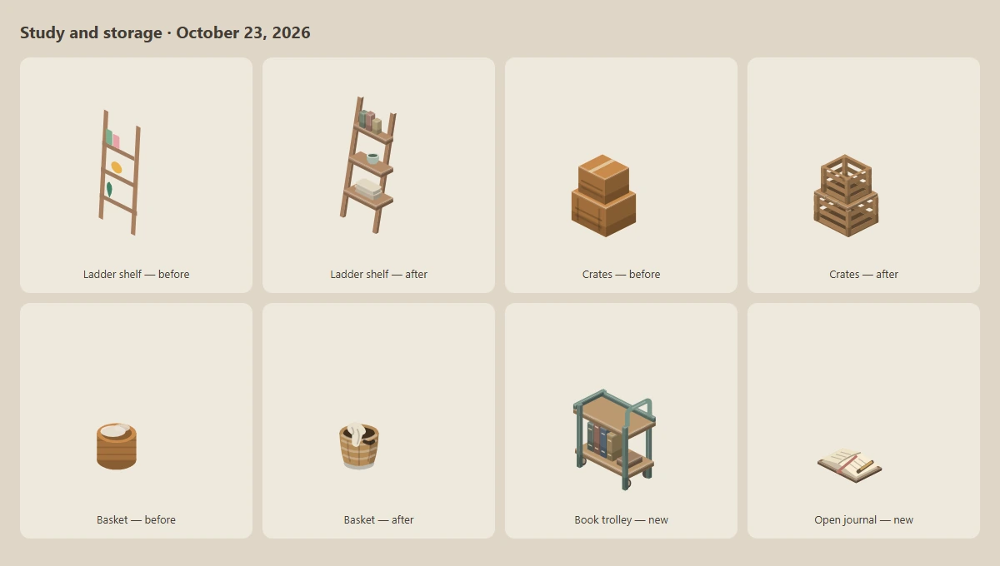
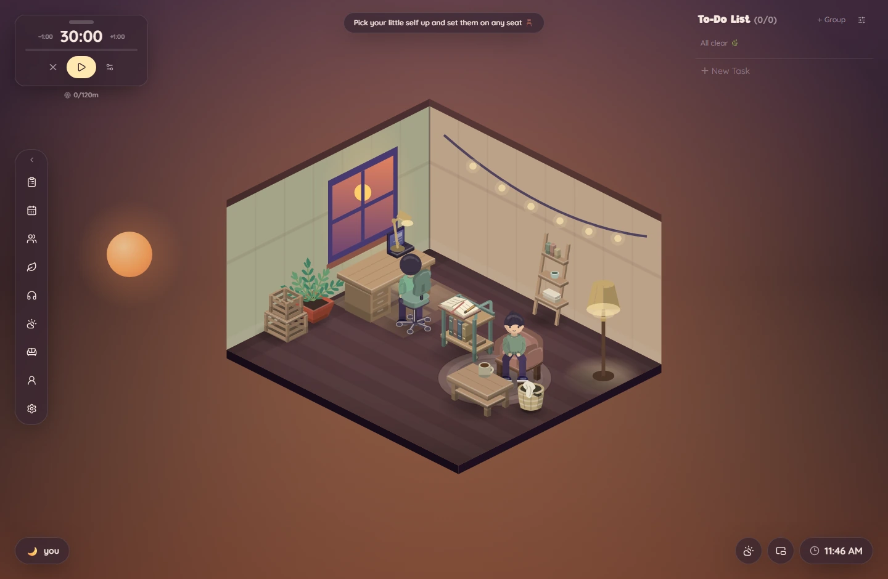

# Catalog and resident modeling review

This records the October 4 catalog/seating work and its October 6 stability
follow-up. Comparison images are review snapshots. The later character
baseline is documented in [the model spec](MODELS.md) and
[the archived handoff](archive/HANDOFF-2026-10-06.md); remaining work lives in
[the modeling roadmap](MODELING_ROADMAP.md).

The main gap from the Virtual Cottage 2 references is the design of each
object: physical construction, distinct silhouettes, layered materials and
characters convincingly settled into furniture. Better colours and more
particles help the atmosphere but cannot replace that work.

## Seasonal silhouettes and Terrace follow-up — October 23, 2026

An independent visual review ranked the oversized seasonal trees above small
prop additions because their silhouettes dominate four presets. The follow-up
therefore improves the existing models in place before expanding the catalog:

- **Maple and blossom trees:** a connected rear crown, overlapping foreground
  lobes and partly occluded branch forks replace stacked ovals. Blossom clusters
  keep a few readable flowers and falling petals at room scale.
- **Snowy pine and Christmas tree:** five broad foreground tiers overlap four
  darker interstitial boughs, breaking up the repeated triangle silhouette;
  snow rests in small offset shelves rather than masking each complete tier.
- **Coconut palm:** nine layered, individually segmented fronds vary in length,
  value and droop around a visible three-coconut crown and ringed curved trunk.
- **Flower cushion:** a new one-tile seat with seven padded petals, a stitched
  centre and the existing seat-placement contract.
- **Folded blanket:** a new stackable textile with three soft layers, broad woven
  bands and loose fringe. It can live on a surface or be left beside a chair.
- **Terrace:** the preset now composes established pieces into a sheltered
  candlelit dining group, a restrained reading corner and an open diagonal
  route. The two new textiles remain catalog choices rather than turning this
  preset into a shop window.

The catalog now has **168 entries across 18 groups**. New textile artwork lives
in `IsoTextileItems.jsx`; existing catalog keys, seasonal footprints and saved
room data remain compatible. The art sheet now includes Terrace plus the three
seasonal yards so future model edits are judged in context as well as in cutouts.

## Outdoor support follow-up — October 24, 2026

The next review kept the seasonal rooms open and improved the supporting
models already present in them. Generic outdoor artwork now lives in the
focused `IsoOutdoorItems.jsx`, while `IsoTreePrimitives.jsx` owns the shared
broadleaf and evergreen crown construction. Pine, Snowy pine and the Christmas
tree reuse one curved five-tier evergreen frame without merging their snow,
garland or ornament details.

- **Autumn:** the leaf pile is a low layered mound of readable leaves;
  pumpkins have overlapping volume and rear-growing stalks; jack-o'-lantern
  openings show a dark recess and warm inner wall.
- **Winter:** drifts have a grounded cool underside, snowballs are unequal and
  hand-packed, and the snow angel is a pressed field with broken rim catches.
- **Spring/garden:** flower patches mix two tint-aware species at unequal
  heights, tulips lean on broad leaves, and the bird bath has a thick basin
  with water below its rim.
- **Summer:** Poolside umbrellas have scalloped panels, underside ribs and a
  weighted base; loungers separate their frame, hinge and tensioned sling.
- **Generic outdoors:** broadleaf, pine, birch, bush, hedge and rock now have
  distinct joined silhouettes rather than recoloured stacks of basic shapes.

The affected Secret Garden, Autumn yard, Winter yard and Poolside screenshots
were recaptured from the built app against an isolated database. Footprints,
seat/surface metadata, saved catalog keys and preset routes did not change.
The final pass completed 1,372 frontend tests with one intentional art-fixture
skip and all 299 backend tests, plus lint, the production build and the full
778-piece art sheet. An independent Codex review found and then rechecked the
flower-patch tint contract; both flower species now follow the selected tint.
The main-channel executable/manifest pair verifies as build
`cb00d92ecc2d4dfcabd5768d298889d9`, and its frozen self-test exited 0 against
isolated app data. Generated review profiles, databases, art output and
packaging work files were removed afterward.

## Scope and findings

The subsequent common-room pass adds fitted necklines and smaller shaped
palms to the shared resident while retaining the restored seating. The eight
requested outfit presets are already available in Profile → Looks; their
closeup sheets are refreshed. Loft, Corner café and Reading room use the
refined plant/lamp models more deliberately. The first fixed split-level
Common Cottage is implemented with six seats and three simulated neighbours;
see [the scene and remaining work](COMMON_ROOMS.md). It is a first art pass,
not a claim that the catalog or character modeling is complete.

## Study and storage follow-up — October 23, 2026

Compared the timber loft and common study/café references against the current
catalog with a second reviewer. The useful gap was everyday construction and
reachable storage, rather than more particles or another character rig.
The design baseline is `dev` at `0c8b1bf`; the earlier checkout/CI patch remains
included in the working tree.

- **Ladder shelf:** three projected boards with real depth, leaning side rails,
  and books, a ceramic bowl and folded linen resting on the shelves.
- **Stacked crates:** separated slats and corner battens replace solid boxes.
  The lower crate has a boarded lid supporting an open upper crate.
- **Laundry basket:** a tapered woven body, bound recessed rim, hand opening
  and one draped cloth replace the straight cylinder and round laundry blobs.
- **Book trolley:** a new low, two-tier cart with casters and a side handle.
  Books occupy the lower shelf; its clear 32 px upper tray accepts ordinary
  tabletop decorations through the existing stacking rules.
- **Open journal:** a new stackable spread with separate page blocks, a binding,
  ribbon and pencil. The cover accepts the user's tint; paper stays paper.

At that point the catalog had **165 entries across 18 groups**. Find the trolley in
Storage and the journal in Decoration. Existing furniture footprints, seat
heights, saved layouts and character poses are unchanged. The models live in
focused storage/study modules instead of enlarging the main sprite file.

The room above is a review arrangement, not an additional shipped preset.
It keeps the window workstation separate from the lounge, places the trolley
within reach of the reading chair and leaves a clear route between both areas.
The ladder shelf was moved away from the floor lamp after the first capture
showed it being obscured. No existing preset was filled with extra props.

Reviewed all five models in natural, light, dark and sage finishes, plus the
built app at 1440×940 and 900×640. Browser checks cover searching for and adding
both new items, saved tints and reload persistence. Placement regressions cover
the journal on the trolley in both facings. The existing catalog checks render
every sprite in every facing; artwork still needs visual judgment.

Validation: 1,365 frontend tests passed with one existing opt-in fixture skip;
the 519 catalog/placement checks were repeated after the final drawing change.
All 117 backend room/packaging/checkout tests passed, along with lint, the Node
20 production build and art generation. The matching main-channel EXE/manifest
passed artifact verification and an isolated frozen self-test (exit 0).
Both reviewers inspected the final models and room captures without blockers.
The disposable browser profiles, databases and generated art sheet were removed
after review; the committed model-review images and room screenshots retain the
visual evidence.

The larger character-perspective and raised-platform-bed gaps remain open.
This pass does not revive the rejected seated rig or claim catalog-wide parity
with the references.

## Earlier October findings

The later compact resident, quieter face/glasses and fitted headgear work is
recorded in [the October 6 handoff](archive/HANDOFF-2026-10-06.md). The subsequent
[stability review](archive/STABILITY-REVIEW-2026-10-06.md) fixes transformed clipping,
seat focus and obsolete visit feedback while retaining that character baseline.

Reviewed all **161 catalog items across 18 groups**, including advertised
rear views and items not used by any preset. The art generator now renders
that inventory alongside the wardrobe, with actual scene paint definitions
and theme variables so glass, screens and rugs do not turn black in isolation.

| Family | Gap found | Work implemented | Still needed |
|---|---|---|---|
| Resident | The skewed chair prototype looked disconnected and unconvincing in the owner's review. | Reverted the experimental head/torso/leg/arm assembly and chair-specific plumbing; restored the established front/rear seated rig. Earlier shaped head/neck/bun improvements remain. | Author a coherent resting pose and its garment silhouette on actual furniture before introducing joints, gestures and body variation. |
| Storage | Flat monolithic wardrobes, featureless drawers and uniform contents. | Wardrobe door frames/insets, hinges, handles and feet; raised dresser; inset shared drawers with brass pulls; open-shelf pottery/basket; record-crate handle and sleeve labels. | Open crate slats, real ladder-shelf boards, cabinet rear construction and deeper contents. |
| Plants | Generic paddle leaves, bare palm poles, star-shaped succulents and mushroom-like bonsai crowns. | Individual plant leaves; feathered fern/palm fronds; variegated snake-plant swords; branching bonsai with lobed leaf pads; layered succulent; orchid petals and basal leaves; cactus ribs/needles. | Ceramic planter alternatives, fuller asymmetric crowns, terrarium contents and matching miniature plants on the display shelf. |
| Trees and bushes | Stacked ovals repeat the same canopy construction. | Shared irregular leaf-cluster primitive on tree, bush and birch, with broad light/shadow masses; visible tree branches. Maple/blossom crowns now overlap connected rear masses, seasonal evergreens interleave foreground/rear boughs, and the coconut palm uses layered segmented fronds. | The later outdoor pass gives pine and hedge distinct silhouettes; future tree work should preserve species differences instead of adding detail to a shared blob. |
| Light and warmth | Lamps resemble simple icons with little assembly. | Bronze-framed stained-glass table shade and pull chain; fabric floor-shade pleats/binding; articulated desk-lamp joints. | Deeper shade rims, curved metal/glass, socket construction and wall/ceiling fittings. |
| Main furniture | Cloth and timber share sharp box geometry. | Rounded floor cushion; layered bedding and shelf interiors; curved armchair/sofa upholstery on open frames, shaped desk-chair shell and padded seat, and a slatted garden bench. Solid primitive has a small projected top bevel. | Beanbag, stool, hammock and authored raised platform bed; furniture joinery and quarter-view sitter contact. A shared bevel does not count as redesigning every item. |
| Other catalog families | Kitchen, food, wall pieces, rugs and seasonal accessories remain uneven in detail. | Complete review coverage and an explicit task for every catalog key. | Individual construction/silhouette work listed in the roadmap, including sinks, appliances, curtain folds, stairs and dishes. |

The roadmap records **23 entries refined this pass**, **6 refined in the
previous pass** and **132 pending individual passes**. Refined means changed,
not finished. Placement footprints, saved wardrobe data and seat heights
remain stable. People remain settled; carrying, standing, sofas, rugs and
lying on beds retain their existing pose behavior.

## Seating follow-up

The owner found the chair too blocky. The empty-chair comparison confirmed
that the rounded footprint still left tall straight arm/back sides and a
solid lower body. The armchair and sofa now use bowed padded panels with
curved vertical edges, visible shell thickness and an open timber frame.
Their seats remain at 22 px. The desk chair retains its caster base and
24 px seat height, with a thinner padded seat over a separate shell and a
rounded, waisted back with readable rear support.

The nearby garden bench had the same construction problem: two solid panels
with tiny feet. It now has individual back/seat slats, support rails and
four legs, preserving its 16 px seat and placement footprint. Reviewed all
four pieces front/rear in cream, dark and sage, plus seated body extremes
in idle/focus/break. The shared character pose is unchanged. Its frontal
front/rear drawing still limits perspective and desk contact; improving
furniture alone does not finish the resident rig.

## Evidence and validation

`npm run art` generates SVG review pieces for the full catalog, complete
wardrobe, material colour variants, body extremes, preset scenes and eight
looks in front/rear seated views for idle/focus/break. The sheet groups catalog
items by their actual catalog family and labels each item/view.
It also renders 48 furniture-contact views and six bench colour/facing views.

The normal screenshot gallery is refreshed from the built app using an
isolated database and browser. The committed comparison sheets in
`model-review/` show the changed plant, storage and lamp families plus the
restored seated rig. These captures expose remaining weaknesses; they are
not a claim of reference parity or proof that animation is flawless.

| Comparison | Captured views |
|---|---|
| [Plants](model-review/plants.webp) | Every plant catalog entry |
| [Storage](model-review/storage.webp) | Every storage catalog entry |
| [Lighting](model-review/lighting.webp) | Every light/warmth catalog entry |
| [Seated front](model-review/seated-front.webp) | Eight looks, break/focus/idle |
| [Seated rear](model-review/seated-back.webp) | Eight looks, break/focus/idle |
| [Live Loft focus](model-review/loft-focus.webp) | The restored seated rig in the actual built app while its timer is running |
| [Seating comparison](model-review/seating-comparison.webp) | Before/after armchair, sofa, desk chair and garden bench, front/rear |
| [Seating colours](model-review/seating-colours.webp) | Cream/dark/sage in both facings |
| [Seated contact front](model-review/seating-contact-front.webp), [rear](model-review/seating-contact-back.webp) | Body extremes on the four pieces, idle/focus/break |

Wardrobe, palette, seat height, placement and rendering checks protect the
current implementation. The rejected prototype's reach/mirror tests were
removed with it. Run lint, tests, the production build, art generation and the
frozen desktop self-test when changing this artwork. Dated validation results
are preserved in [the stability review](archive/STABILITY-REVIEW-2026-10-06.md).

Live checks cover all three open seats, timer continuity, unchanged home
layout/camera, the fixed-room decoration guard, reduced motion and the
600 × 420 seat controls. Tabletop objects reuse catalog surface heights and
supporting-furniture paint order; the scene supplies every referenced SVG paint.

The original seated rig is the current baseline. The rejected skewed torso
and profile-head substitution must not be treated as a completed model
improvement. The next approach is a coherent static pose and garment design,
then furniture contact and occlusion, and only then animation/customisation.

See [the complete per-item roadmap](MODELING_ROADMAP.md) for what to do next,
[the model spec](MODELS.md) for current contracts and
[the earlier reference pass](ART_REVIEW.md) for the bedding/profile work.

---

## Earlier seated clothing review

### Findings addressed

- Seated skirts, pleated skirts and maxi skirts reused separate cloth thighs,
  making them look like shorts. They now share a continuous lap panel, with
  distinct hems and folds. The maxi length follows the seat height.
- Sitting removed denim's rolled hems and stitching and dress trousers'
  pressed creases. The seated drawing now preserves these material details.
  Bare shins also draw behind shorts, preserving the cloth hem at the knee.
- The desk chair's dark spokes disappeared against dark floors and had no
  wheels. Its base now has visible casters and warm metal edge highlights.
- Artwork comparison tests counted unique React IDs as visual differences.
  Comparisons now ignore instance IDs and descriptive data attributes, and
  check that every bottom remains distinct at three seat heights.

### Review coverage

Inspected rendered SVG contact sheets for clothing and furniture, light and
dark skirt colours, both character models, and minimum/maximum body sizes.
Checked the seated clothing and desk chair together in rendered Loft scenes.
These are static render checks; they do not exercise live drag or animation.

The opt-in art-sheet generator includes the expanded fixtures for future
reviews. The model spec records the seated clothing rules. No profile data
format, furniture placement geometry or saved wardrobe selections changed.
