# Standalone furniture study — November 11, 2026

**November 12 update:** [production integration](../../ROOM_MODEL_INTEGRATION.md)
now uses all 179 furniture/prop GLBs in the actual isometric rooms. The five
customized actor types keep their SVG rigs. This authoring report retains the
earlier workshop findings; its integration limitations are superseded by that
current implementation report.

The owner identified inaccurate construction and disconnected-looking parts
as the main furniture problem, authorized the standalone prototype, and then
asked for a less realistic treatment using **Virtual Cottage 2** as the style
reference. **All 184 entries in all 18 catalog sections now have standalone
GLBs.** The latest round adds the remaining 124 plants, decorations, electronics,
architecture, wall fixtures, kitchen/tabletop pieces, seasonal/outdoor models
and living entries. [The generated tracker](../../CATALOG_3D_MIGRATION.md) lists every
covered key, asset and export statistic. [The approach](../../CATALOG_3D_APPROACH.md)
records construction, source ownership, review and cleanup. Export coverage is
separate from production deployment.

[The review index](../../model-review/README.md) links the complete set of 18 section
sheets. The first five furniture sheets below retain their original context.

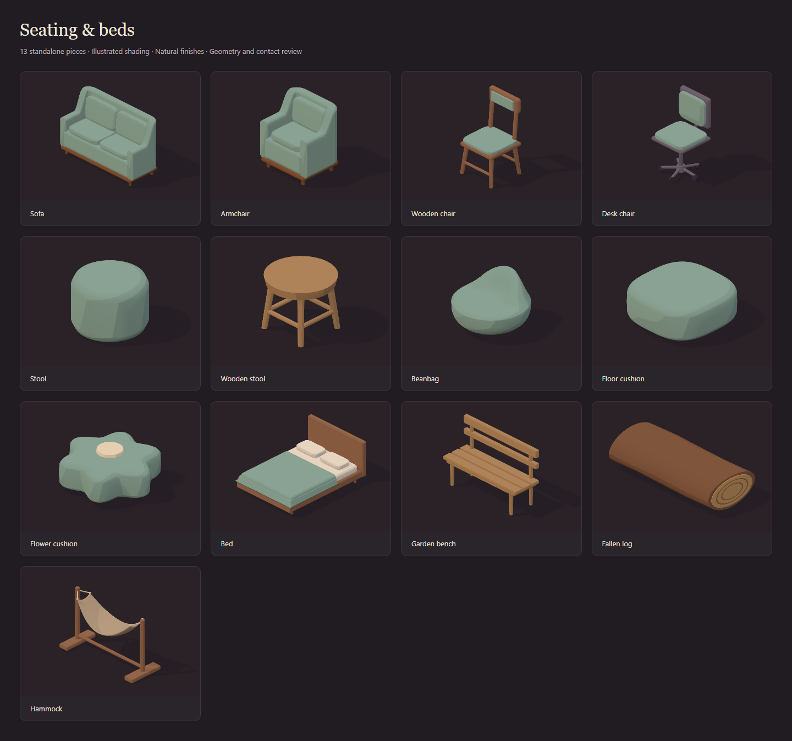

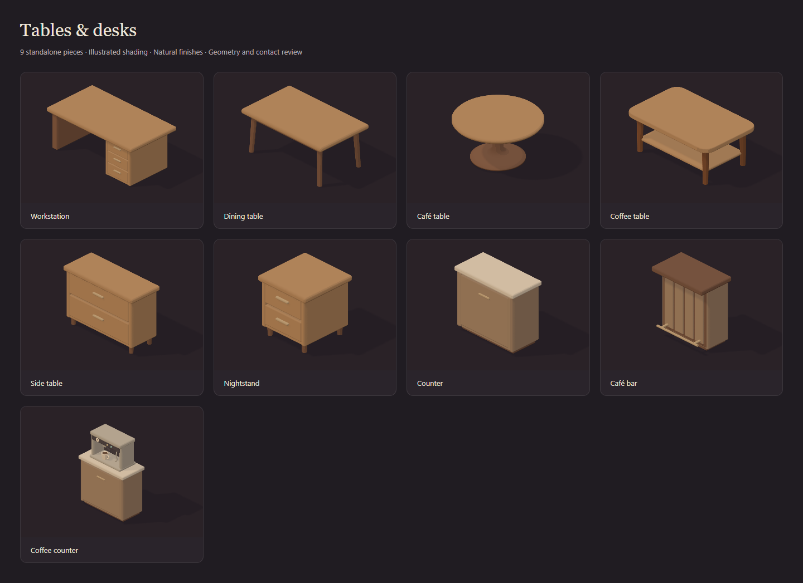

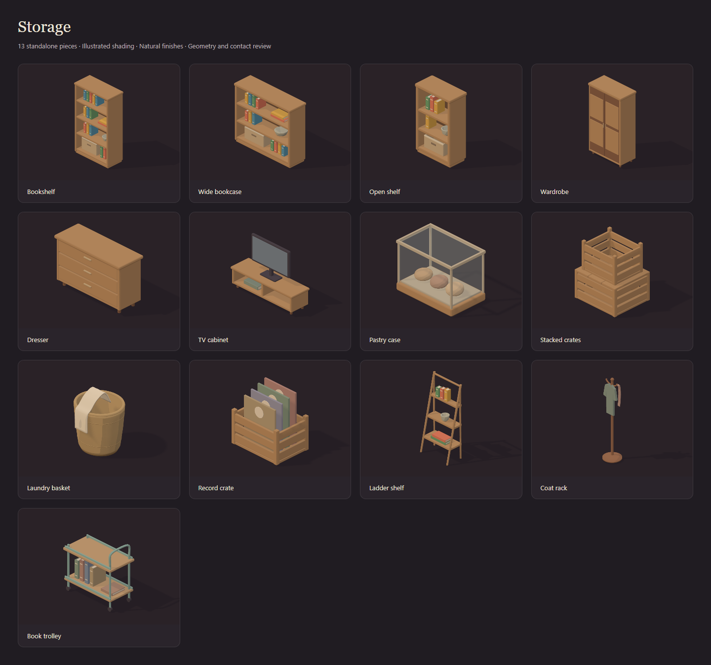

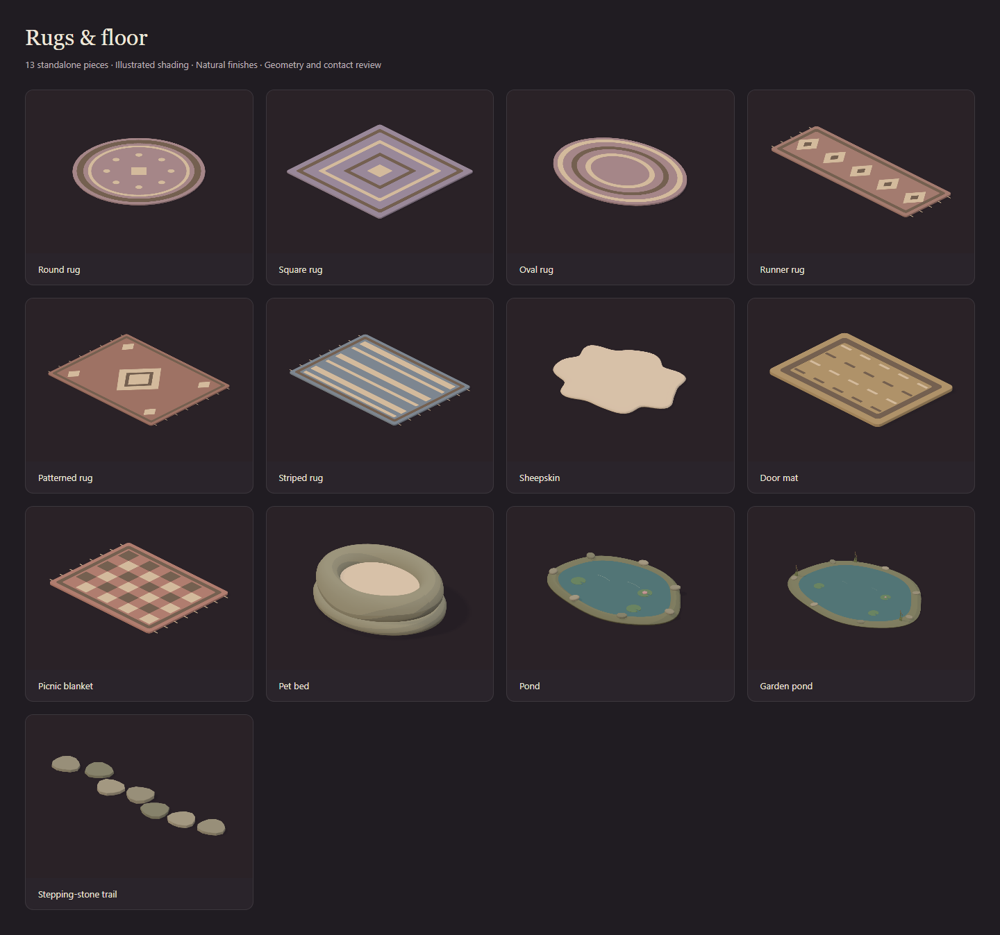

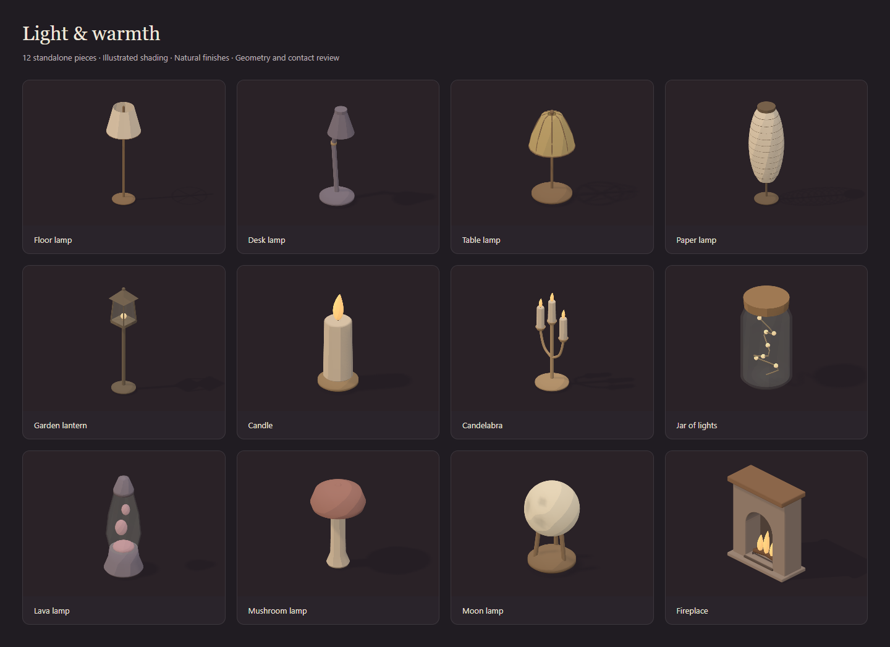

## Current design

Illustrated shading is now the default: broad matte value bands, restrained
cast shadows and muted plum room surfaces. Original lighting remains available
for direct comparison on the same geometry. Source furniture still has full
rear/underside construction; changing the shading does not replace connected
parts with camera-specific patches.

The reference is the supplied Virtual Cottage 2 art: readable rounded silhouettes,
chunky upholstery, warm timber and limited material detail at normal room scale.
This pass interprets those cues in original TaskNook models. It does not trace
or import the reference artwork. The [first physical-lighting room capture](images/furniture-3d-room.png)
is retained as the earlier comparison, not the current default.

The [source and workshop](../../../prototypes/furniture/README.md) live in
`prototypes/furniture/`, with a separate pinned dependency lockfile. Node 20
generates the GLBs directly; Blender was not installed or used. GLBs contain
portable matte PBR materials and named material roles. The illustrated toon
palette is applied by the runtime viewer; it is not baked into the portable
asset or guaranteed to appear identically in another editor.

Per-asset triangle counts, GLB byte sizes and download links are generated from
the export manifest in [the migration tracker](../../CATALOG_3D_MIGRATION.md#sections-with-full-asset-coverage).
They are no longer duplicated by hand in this report as the catalog grows.

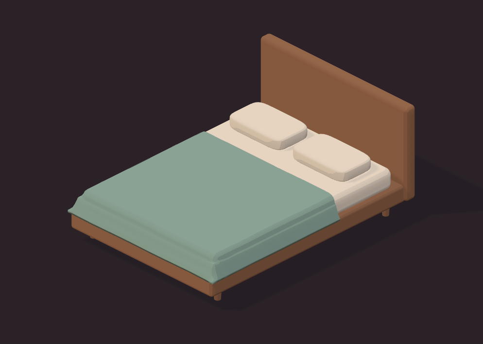

Every individual mesh is closed, connected and outward-facing. Multiple meshes
represent physical parts such as cushions and feet; a complete standalone asset
does not imply one fused material or mesh. Interior overlap at a timber joint
or cushion support is intentional.

The model origin is centered on its footprint, grounded at Y=0, facing +Z.
Existing catalog widths/depths are retained. At the room's 2:1 dimetric view,
`48 / sqrt(2)` screen pixels represent one world unit. Each piece retains its own catalog seat/surface anchor; supported chair seats
range from 16 to 24 px, work surfaces retain their individual catalog heights and the mattress
anchor remains 18 px. `controlHeight` retains the catalog hit/control bound
separately from the authored physical height; a cushion is not inflated to
fill the space reserved for its edit controls.
Catalog drift and model bounds are checked against the actual frontend data.

The workstation has a side panel, a three-drawer pedestal, a rear support rail
and open knee space. It is a standalone bare desk; the production renderer's
conditional laptop still belongs to the later equipment/integration work.
The dining table has an open apron frame; the round café table has a continuous
turned pedestal. Drawer cabinets use a panel-built case, supported fronts and
short grounded feet. The cupboard has a recessed plinth and neutral stone top;
the taller bar adds panelled frontage, a customer overhang and a bracketed rail.
The espresso machine has an open brewing bay, connected grouphead/handle/wand,
a grounded tray and a hollow cup with coffee inside its rim. Drawers are static
artwork, not newly implemented opening interactions.

The storage family uses recessed cabinet backs, attached shelves and supported
books, folios, ceramics and linen bins. The ladder shelf has grounded rear
uprights so it can stand without an implied wall. Crates have separate inset
slats and corner battens; the upper crate rests on the lower crate's boarded
lid. Records rest on their crate floor. The basket is one hollow casing with a
bound rim and a continuous cloth that clears its visible surface.

Wardrobe doors and dresser drawers are static artwork. The TV cabinet retains
the original catalog identity's integrated television, with a complete casing,
stand and stem. The pastry case has framed transparent glazing and a supported
tray; transparent materials keep their opacity across shading changes and do
not cast opaque shadows. The trolley has four grounded casters, joined posts,
a push handle and a clear top at the existing 32px catalog surface. The coat
rack's hooks, hanger, coat and scarf connect to a continuous mast.

The floor family adds genuinely round/square silhouettes, shallow woven inlays,
attached fringes, a single soft wool casing and a continuous dipped pet-bed
bolster over a soft base. Textile patterns enter the backing; their exposed
pile is at most 0.002 tile high. They do not cast separate raised-pattern shadows.
Round/square artwork uses the available area inside its existing reserved footprint.

The ponds are closed basins with a recessed water volume, fitted bank stones,
notched lily pads and supported flowers. The larger pond adds rooted reeds.
Water meets the inside of its shoreline; it is a static illustrated material,
not a production water shader or animation implementation. Seven separate trail
stones each have their own floor contact. The catalog's fixed palettes, floor
layer and soft-seat flags are preserved; ponds and the trail disable recolouring.
Floor sitting, pet occupancy, swimming and production navigation remain integration work.

The lighting family adds weighted bases, connected pivots/spokes, hollow shades,
ribbed paper, fitted glass enclosures and attached wires. Candle dishes and
branched stands receive actual wax, wick and flame volumes. The moon has a
three-prong receiving cradle, carved craters and vertex pigment preserved by
both shading styles. The fireplace has a complete back, real arched opening,
recessed lining/floor and a joined grate receiving the logs and flame forms.

Portable emissive materials supply the illustrated glow. The workshop's light
switch preserves intensity, tint and the current on/off state across shading
changes and lazy loads. Fabric/glass shades have restrained surface emission;
metal shades retain their opaque finish. Direct underside inspection exposes
their recessed bulbs. These are static asset/material previews: scene light
pools, daylight scheduling, flame motion and production glow/flicker behavior
remain integration work. Original catalog stacking/glow/flicker metadata is retained.

The workshop offers Lounge, Study, Café, Storage nook, Textile lounge and Hearth & lamps arrangements. These are original
isolated review layouts, not production presets or saved user rooms.

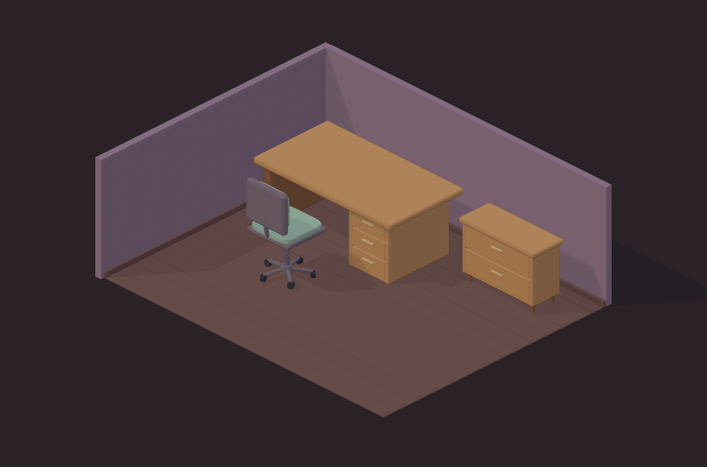

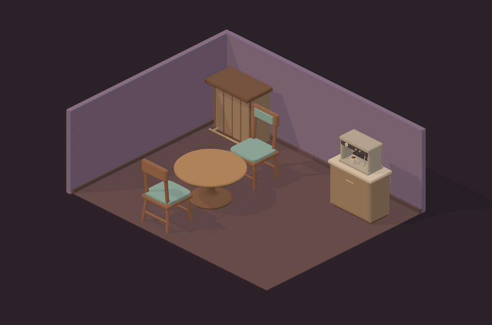

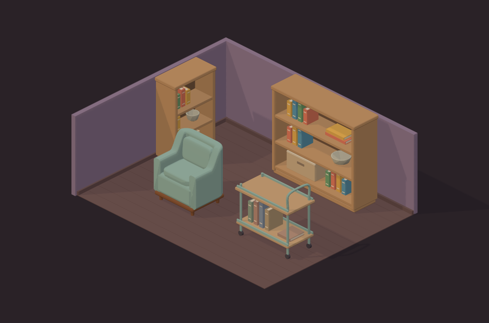

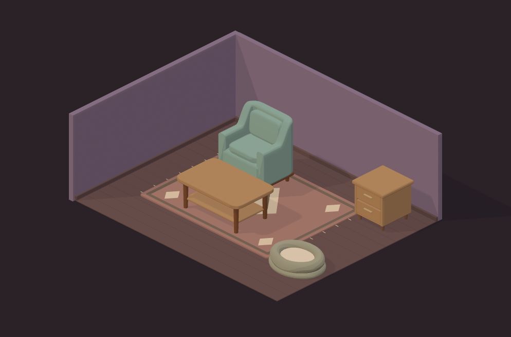

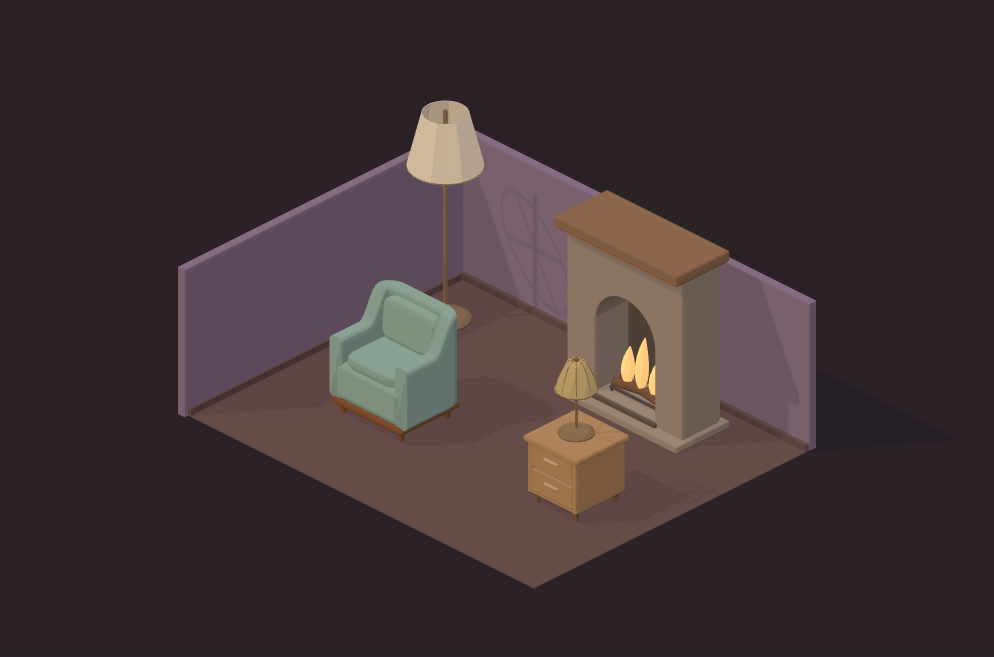

The textile lounge raises furniture to the rug's height; its feet are checked
against the actual rug surface. Room boards now meet the model floor at Y=0.
Floor pieces use elevated front/rear inspection angles so thin stones and
textiles remain readable instead of being viewed almost edge-on.

## Actual-character calibration

The five Living things GLBs additionally have articulated rigid-part hierarchies
and portable two-second Idle/Walk clips. The workshop plays them on request,
restores their bind pose on stop/selection changes and resumes demand rendering.
They have static outfits/coats. Production wardrobe/body sliders, pet growth,
seated/lying/carry poses, navigation and all-angle furniture contact remain
separate integration work. The original SVG calibration described below is
retained alongside these starter 3D rigs.

The Seating check uses self-contained SVG figures exported from the real
`Resident` component, actual outfit presets and the Compact/Broad body templates.
It offers four looks and three builds on seven supported seats: sofa, armchair,
wooden chair, desk chair, upholstered stool, wooden stool and bench. Sixty
source fixtures cover the five different seat heights. Lying/floor-sitting
checks remain separate work for the bed, hammock, beanbag and floor cushions. A source fingerprint
makes stale comparison figures fail the automated checks. Regeneration reads
the frontend through its own JSX/React toolchain and accesses no user data.

This is a fixed **front-view** scale/style calibration. A cutout plane places
the existing drawing at the seat anchor, with rotation disabled. It establishes
neither a rigged 3D character nor all-angle limb contact, wardrobe deformation,
carry animation or occlusion in the production SVG room. The comparison plane
is review tooling, not a proposed replacement for continuous customization.

## Verification

`npm.cmd test` passes 580 tests covering:

- Finite vertices, nondegenerate triangles, closed manifold edges, consistent
  winding, positive volume and a single connected surface per mesh.
- Actual mesh-interior probes at feet/frame, legs/top, shelf/legs, apron/legs,
  deck/arms, cushion/deck, mattress/frame, pillow/mattress and blanket/mattress
  contacts. A broad-phase support graph also detects isolated parts.
- Cabinet panels, drawer supports/pulls, pedestal/top, bar-rail brackets and
  espresso-machine joints use mesh-interior probes too. Worktop raycasts check
  that stacked objects would land at the existing surface height. Knee space
  and the brewing bay are sampled to reject an incorrectly solid enclosure.
- Bed-cover vertices and triangle centroids raycast against the actual mattress
  to catch cloth cutting through its top. These samples are not an exhaustive
  solid-intersection or self-intersection proof.
- Stored contents rest at their support's top and clear shelves above them.
  Shelf backs are recessed; shelf joints, crate stacking, caster/posts, hanger
  and cloth/rim contacts are checked. Visible basket-cloth vertices and triangle
  centroids are checked against the actual wicker/rim mesh interiors.
- Textile pile enters its backing without becoming raised plates; round/square
  silhouettes match their names. Horizontal mesh intersections check that water
  meets its shoreline below the bank top. Separate trail stones must each touch
  the floor, and all four feet of the furnished chair/table must rest on the rug.
- Floor contact, footprint/height limits, catalog anchors and a 16,000-triangle
  ceiling per asset.
- Zero Khronos glTF validation errors/warnings; embedded buffers, no external
  GLB textures, manifest hashes and reloaded geometry/material/transform parity.
- Shared toon material roles, nearest-filtered shading bands and recoloring
  preserved across switches between illustrated and original materials.
- Open shade centres and receiving walls, retained emission/radiance and shadow
  hints in GLBs, lit/unlit state across variants and lazy loads, lunar vertex
  pigment, enclosed wax bounds and the fireplace's actual opening/jambs.
- Sixty current character fixtures covering the declared looks/builds/heights.
- Complete 18-section coverage, every production placement/interaction flag,
  export-manifest/catalog parity and invisible
  character geometry excluded from standalone camera framing.
- Actual openings in the sink, carved pumpkin, mug and kettle spout; round mirror,
  spherical ball, low fallen leaves, round barrow wheel, exposed snow caps,
  reclined lounger and existing seasonal seat supports.
- Exported articulation channels, changing joint transforms, sampled foot-floor
  clearance throughout both clips and exact bind-pose restoration after stopping.
- Selected-model material ownership and fixed palettes across shader variants.
- Local server delivery, rejected writes, missing assets and path containment.

`npm.cmd run qa` passes in isolated headless Chrome 156.0.8078.49:

- 1,524 asset/color/view captures: 162 tintable assets in sage/cream/ink, plus 22
  fixed-palette assets, each at room angle/rear/underside.
  Camera changes and visible recolors are checked. The bed's rear headboard
  legitimately hides the linen, so its hidden recolor need not change pixels.
- 84 fixed-front character captures, plus pointer checks that rotation stays locked.
- Natural-finish contact sheets covering all 184 items in all 18 sections.
- Lounge, Study, Café, Storage nook, Textile lounge and Hearth & lamps arrangements; room-load failure retains the previous
  arrangement, retry clears the error, and a late response cannot replace a newer choice.
- Section navigation, lazy startup loading of only the three room assets, cache
  reuse, retry after optional-asset failure and stale-selection protection.
- Fixed-palette models disable the colour controls; returning to tintable
  furniture restores them.
- All 24 emissive models switch off/on with visible emission changes and exact
  finish restoration. Open shades are inspected from below to expose their bulb.
- Both clips on all five living entries visibly move the rendered rig and restore
  the still image exactly when stopped.
- Illustrated/original lighting comparison with exact selected-color restoration.
- Actual GLB download matching the supplied bytes; room camera changes, custom
  recoloring, pointer orbit and wheel zoom.
- 390px object and contact layouts without horizontal overflow; keyboard controls.
- Missing-model failure feedback, no continuous idle rendering and no console
  errors/page exceptions/failed requests in the successful flow.

Visual review checked light/dark furniture, rear/underside construction, the
room and the actual-character views. It corrected the first blanket's diagonal
intersection with the mattress, refined its corner sampling, removed a seat-front
depth overlap hiding the character's legs and enlarged the figure frame to keep
bun/hair silhouettes visible. Tests establish technical contracts; the owner's
visual judgment remains the art-direction acceptance criterion.

The Tables & desks review checked natural/sage/cream/ink materials and the
rear/underside of the joined supports, cupboard, bar and brewing bay. It corrected
small drawer/cupboard pulls that projected beyond the catalog footprint and
checked the cup handle and liquid against the cup's actual wall geometry.

The Storage review checked the complete family, light/dark tints, rear/underside
construction and the furnished nook. It corrected coplanar cabinet back faces,
cloth cutting through the basket rim, a solid lid hiding the pastry-case glazing,
and added rear supports to the ladder shelf. Small books and timber details use
lighter bevel sampling within the existing per-asset triangle ceiling.

The Rugs & floor review checked the complete family and its furnished lounge.
It corrected inlay-hole winding, simplified degenerate reed caps, joined water
to the shoreline, softened the pet-bed base and replaced painted wool spots
with a continuous crowned casing. Thin ground pieces use elevated inspection
cameras. Blank-frame smoke checks accept colour variation or broad low-tone
coverage, so visibly rendered dark metal is not mistaken for an empty image.

The lighting review checked source/shade contacts, rear/underside construction,
the complete family and the hearth arrangement. It fitted paper-cap spokes to
their actual profile, resolved lantern bounds, thickened the desk arm and pillar
candle, broadened the mushroom cap and added readable lunar pigment. The grate
has receiving side rails joining all crossbars. Bulb appearance is checked
through the opening as well as at the normal room angle.

The remaining 13 sections were authored and reviewed as separate families.
Physical heights remain distinct from edit-control bounds: the review shortened
tabletop vessels, bread, pie, seed trays, baskets and the sled instead of stretching
their parts to fill their hit areas. It corrected a rectangular round mirror,
hidden hob burners, a buried aquarium light, snow hidden inside pine foliage,
upright fallen leaves, an upright lounger and a planter-shaped wheelbarrow.
The final underside check added actual chassis-to-tray crossmembers and struts,
with solid-interior probes. Plant review broadened drooping leaves, fitted the
fern to a squat pot and extended petioles into their receiving leaf volumes.

The successful full-catalog run covered all 1,524 views and all interactions.
A subsequent 270-view Plants & greenery / Autumn run rechecks the final foliage
and tray-support changes; unchanged sections reuse the full run's evidence.
Both reports are retained under the ignored verification directory. This is
render/interaction coverage, not a dense-scene frame-time benchmark.

Evidence is in ignored `build/skill-verification/furniture-3d/`; the images above
are retained review snapshots. Generated fixtures and GLBs are reproducible.
The previously retained preview server was stopped and 318 obsolete temporary
captures were removed. QA now removes old captures before running and discards
intermediate images/HTML after a successful run, keeping section/room/UI summaries
and the report. Failed runs keep diagnostic captures. Set
`FURNITURE_KEEP_CAPTURES=1` for a detailed review, then use `npm.cmd run qa:clean`.
Report capture filenames identify the checks performed; `rawCapturesRetained`
and `retainedImages` explicitly distinguish retained files from intermediates.
Final cleanup removed 390 last-round angle/contact PNGs and HTML intermediates.
All 18 current section sheets are archived under `docs/model-review/`; an unused
early room capture was removed. Compact test/export logs and full/scoped QA
reports remain ignored. Owned preview servers and browsers are closed.

## Structural review and delivery boundary

The full prototype source, QA scripts and tests also pass ESLint checks for
unused declarations and undefined names (55 modules). Family constructors stay
explicit, and reusable helpers model actual receiving parts instead of serving
as a generic fallback. Per-model material scope prevents similarly named snow,
cloth and timber materials in unrelated assets from changing together.

The shared agent toolkit was unavailable in both documented install locations;
review used the local project adapters and does not claim the full upstream
rubric. Local review checked asset/source separation, material ownership,
render scheduling, stale-load cancellation, bounds, lifecycle and server paths.
Rendering palettes and the fixed-view character check have separate modules.
Shared closed-surface primitives live in `geometry.mjs`, the new seating family
in `seating-models.mjs`, and source catalog/section metadata in `catalog.mjs`.
The worktop family is in `table-models.mjs`; cabinet construction and the espresso
machine have focused modules. `room-layouts.mjs` owns the review arrangements.
Storage has separate shelf, cabinet, container and fixture modules, with shared
book/cloth/board construction in `storage-parts.mjs`. QA cleanup is confined to
recognized regular capture files under its owned workspace output; it does not
recurse into other directories or remove source assets.
`rug-models.mjs` and `ground-water-models.mjs` own the ground family;
`ground-shapes.mjs` owns its closed outlines, profiles and connected inlays.
The lighting family has focused lamp, decorative-light and fireplace builders
with closed shells and source helpers in `lighting-parts.mjs`. The palette owns
emission variants and the switch state; it normalizes portable GLB source
metadata before applying recolours, avoiding intensity changes across loads.
Migration statistics are generated by `migration-report.mjs` from the same
manifest used by the viewer. Floor-only material hints remain local to the
prototype and portable GLB extras.
Authors must register an explicit builder; unknown asset keys cannot fall
through to generic furniture. The viewer reads the manifest and lazy-loads
selected GLBs, keeping unvisited sections out of startup parsing/GPU memory.
A hidden calibration plane was found to distort standalone camera fitting;
visible-child bounds and a regression check now protect that boundary.

This study changes no shipping application source, persistence, migrations,
catalog keys or desktop packaging inputs. Existing outgoing changes are retained.
The frontend/backend suites and executable rebuild were not run for this isolated
tool; they are required when rendering is integrated into the app.

## Completed catalog and remaining production work

No catalog asset section remains to author. The ledger and retained sheets cover
all 184 pieces. Asset export is distinct from switching the shipping renderer;
the furniture integration is now implemented in [the live game](../../ROOM_MODEL_INTEGRATION.md).

1. Continue art-direction refinement against the supplied Virtual Cottage 2
   references when the owner reviews the complete set.
2. Establish actual three-quarter character poses and all-angle seating contact,
   including wardrobe/body extremes, hands, carries and rotations. The fixed-front
   calibration does not establish these contracts.
3. The production depth strategy now uses on-demand GLB renders in the existing
   SVG layer order. The workshop's fully 3D review room remains separate.
4. Check dense scenes, GPU memory, frame times and native WebView2. The small
   demand-rendered review scene is not a full-app benchmark.

This extends the [modeling roadmap](MODELING_ROADMAP.md#renderer-decisions).
The model spec remains in force for the shipped grid, contacts and actors.

The subsequent [character/pet review](../../CHARACTER_PET_REVIEW.md) preserves the cute
production SVGs, refines the two 3D starter residents, groups source into
`src/models/` and `src/viewer/`, and records full application stability checks.
